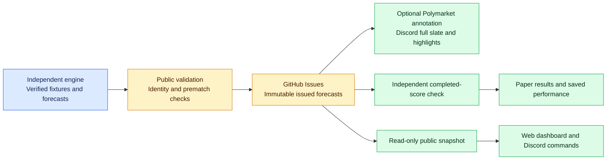

<div align="center">

# ⚽ StatRally
### The Edge Is in the Data.

**Soccer BTTS research • automated experimental paper picks • on-demand Discord lookups**


**[Get StatRally on Discord](https://discord.com/oauth2/authorize?client_id=1567283370419814472) · [How it works](#-how-statrally-works) · [Slash commands](#-on-demand-discord-commands) · [Milestones](#-milestone-tracker) · [Roadmap](#-what-comes-next)**

<sub>Project snapshot: November 3, 2026 • America/Chicago • Public automation repository</sub>

</div>

---

## 💡 Why I built StatRally

I couldn't find a soccer analysis tool that gave me the **Both Teams to Score (BTTS) trends** I wanted for my own betting research. I also wanted to **automate daily picks**, rather than repeat the same manual research each morning.

So I started building StatRally: a data analytics project connecting soccer research, controlled prediction publishing, match verification, and performance tracking.

**My goal:** an accessible soccer research experience where I can explore BTTS trends and see exactly what the automation posted, when it posted it, and what happened afterward.

**StatRally is currently a free public beta, not a proven betting system.** The prediction platform records BTTS YES/NO forecasts independently of betting-market availability. Discord and the read-only dashboard consume those same records; richer historical team-trend exploration remains future work.

> [!IMPORTANT]
> **No validated betting edge or realized profit is claimed.** Model probabilities and paper picks are research outputs, not betting recommendations. StatRally does not place trades or wagers, connect to a user's betting account, or generate extra official picks when a slash command runs.

## 🌱 Free public beta and future plans

**StatRally's Discord community, Discord slash-command app, and read-only web dashboard are free during public beta.** Hosting/deployment verification is distinct from implementation; there's no subscription or payment required to try the available features.

**Pricing after beta has not been decided.** I may introduce optional paid features in the future, such as deeper historical analysis, custom filters, or advanced team comparisons. Those are **ideas, not launched products or promised subscriptions**. The features, price, timing, and long-term free offering will depend on data quality, reliable operation, user feedback, and demonstrated demand.

If monetization is introduced, I plan to explain **what stays free, what is new or paid, and when any changes take effect** before charging anyone. No one is automatically subscribed or billed by joining this beta.

The **private Trade Desk** is a separate owner-only project, not part of the public beta or a paid Discord offering.

## ✨ What works right now

| Feature | Status | Actual behavior |
| :--- | :--- | :--- |
| 🗓️ Daily fixture watchlists | ✅ Implemented | Formats and publishes supported fixture data to the watchlist channel |
| ⚽ Full BTTS prediction slate | ✅ Implemented | Retains every valid same-day forecast, including fixtures without Polymarket markets |
| ⭐ Experimental paper highlights | ✅ Implemented | Separate policy-approved shortlist, **0–3 per Central calendar day**; currently no validated approvals |
| 🔒 Duplicate protection | ✅ Implemented | Guards against repeated official picks and uncertain delivery |
| 🧾 Results and performance tracking | ✅ Implemented | Grades issued forecasts independently of Discord/market availability; genuine forward lifecycle acceptance remains separate |
| ⏰ Resilient scheduling | ✅ Implemented, monitored | Five-minute continuation mechanism with persisted checkpoints and UTC cron backup |
| 🚨 Admin monitoring | ✅ Implemented | Reports missed/failed operations without routine no-pick or success alerts |
| 💬 Discord slash-command app | ✅ Live beta | Hosted, installed, registered, and **/picks verified in a real Discord interaction** |
| 🗃️ Public read-only record fallback | ✅ Deployed | Serves recent verified public snapshots if GitHub API returns HTTP 403/429 |
| 📈 Full historical BTTS team analytics | 🔨 Not built | No live last-5/last-10, team, league or home/away trend exploration yet |
| 📱 Mobile-friendly public dashboard | ✅ Implemented; hosting verification separate | Full slate, highlights, forward performance and immutable prediction history |

The **implementation** of a feature is not proof of uninterrupted unattended operation. Live acceptance, statistical coverage, and profitability are separate questions.

[November 5 operational evidence](docs/independent_platform_verification_2026-11-05.md): eight genuine forecasts were independently saved and delivered, including six without a verified market. Hosted dashboard activation and an actual completed grading lifecycle remain separate acceptance items.

## ⚽ BTTS in 30 seconds

**Both Teams to Score (BTTS)** evaluates whether **both teams score at least once** in regular match time, including stoppage time. Extra time and penalty shootouts do not count in the current result-grading logic.

| Market | Example result | Outcome |
| :--- | :--- | :--- |
| 🟢 BTTS YES | 1–1 or 2–1 | Both sides scored |
| 🔴 BTTS NO | 2–0 or 0–0 | At least one side did not score |

A completed match is not graded merely because a score appears somewhere; StatRally also checks supported fixture identity and final-match status. Unsupported or unconfirmed outcomes stay pending.

## 🔄 How StatRally works

The public project focuses on reproducible **delivery, accountability, and reporting**. Model research remains private.



The command app reads existing records; it does **not** execute a fresh model scan. A successful Discord message is evidence of delivery, not of a correct prediction.

## 📣 Scheduled Discord experience

| Channel | What you see |
| :--- | :--- |
| **#match-watchlist** | Daily fixtures and kickoffs; a fixture is not automatically a pick |
| **#btts-picks** | All same-day BTTS forecasts use **blue Discord embeds**, regardless of YES/NO; separately policy-approved **Top 3 highlighted picks** (0–3 maximum per Central day) use **orange embeds** in this same channel. No extra channel or approval bypass |
| **#btts-results** | Individual verified BTTS results, with green WIN and red LOSS outcomes; retain this channel |
| **#daily-results** | **Implemented; live delivery not yet verified:** one automatically generated blue daily embed with overall W–L, YES/NO accuracy, green/red graded-outcome bar, pending counts and a separate recorded Top 3 sample; no individual result posts |
| **#weekly-recap** | **Implemented, awaiting live Discord verification:** calendar-free Sunday–Saturday recap with overall accuracy, YES/NO, daily graded breakdown and separate Top 3 metrics |
| **#monthly-recap** | **Implemented, awaiting live Discord verification:** monthly accuracy image calendar with green/red/gray cells only and separate Top 3, overall, YES/NO, activity and pending metrics |
| **#model-performance** | **Implemented, awaiting live Discord verification:** forward model-version accuracy, YES/NO precision/recall, Brier score, log loss, matched baseline when available and small-sample warning |
| **#bot-commands** | On-demand, private slash-command replies |
| **#admin** | Owner-only operational alerts and health reports |


### 📊 Automated daily results (implementation merged separately; live delivery pending webhook)

The daily workflow targets **8:15 AM America/Chicago** and reconciles the previous seven calendar days to `#daily-results`, using only saved, verified forward predictions and their finalized grades. It must not fabricate results from chat messages, replay test fixtures or score predictions that remain pending. Individual verified matches continue in `#btts-results`.

**Accounting invariant across all four reports:** Every highlighted Top 3 fixture is already part of the full prediction slate. Overall accuracy counts the first issued forecast once per fixture, including highlighted fixtures. Top 3 accuracy is a separate *breakdown of that same total*, not additional predictions and not an additive second pool. A day with 10 graded forecasts of which 3 are highlighted has 10 overall graded forecasts, not 13. Pending results never count as losses.\n\n**Top 3 performance:** Includes a separate summary for actual highlighted picks only (correct/incorrect, graded count, pending count, accuracy when the denominator is nonzero). Calculate this from durable `top` selection/delivery and verified grades; do not assume that the top three exist every day, or count the same forecast twice. Keep Top 3 performance distinct from the overall slate and YES/NO breakdown. This section is implemented with regression tests; genuine Discord delivery still requires the dedicated webhook secret and live acceptance.

**Display:** a Discord embed headed `StatRally | Daily Results • YYYY-MM-DD` with three prominent accuracy fields (Overall, BTTS YES, BTTS NO), a compact green/red correct/incorrect visual bar or emoji equivalent, and a table-like breakdown of correct, incorrect, total and accuracy per side. Also show pending/ungraded counts, graded sample size and model version/source when available. Use blue branding for the summary, green for correct and red for incorrect. If a side has zero graded forecasts, show `N/A (0 graded)` rather than 0% or 100%.

**Example layout only, supplied by the owner for November 6, 2026 (not ledger-verified):**

| Prediction | Correct | Incorrect | Accuracy |
| :--- | ---: | ---: | ---: |
| BTTS YES | 2 | 0 | 100.0% |
| BTTS NO | 2 | 1 | 66.7% |
| **Overall** | **4** | **1** | **80.0%** |

**Delivery safeguards:** canonical saved final grades only; deduplicate by first issued forecast per fixture and kickoff date in Central time; label ungraded fixtures as pending; post once per date with a durable Discord receipt and edit the existing message when newly verified finals change the snapshot. Ambiguous posts and edits fail closed for manual review. Regression tests cover YES/NO aggregation, separate Top 3, pending records, repeat runs, revisions, and DST. A workflow failure is visible in GitHub Actions; dedicated owner-admin alerting for this new report remains future work. Real Discord acceptance is not yet verified. Configure the GitHub Actions secret `STATRALLY_DAILY_RESULTS_DISCORD_WEBHOOK` with a webhook created in `#daily-results` before enabling live publication. This does not require using a general picks/results webhook.


### 📅 Automated recap reports (implementation; Discord acceptance pending)

The [recap workflow](.github/workflows/recap-reports.yml) targets **9:10 AM Central daily** (GitHub schedule best effort; timezone gate handles DST). Weekly reports are created **on Sunday morning** for the **previous complete Sunday–Saturday week**. Monthly reports display the **current calendar month to date** and update the *same* Discord message as verified results arrive; the model-performance report also updates its existing message. Only final verified forecasts are counted; pending cases are disclosed but not scored as incorrect.

The **weekly layout has no calendar**. It shows weighted overall accuracy (total correct / total graded), YES/NO, Top 3 and a seven-row day-by-day breakdown. The **monthly report includes a real PNG image** with Sunday-first calendar cells: green for a descriptive daily accuracy at least 70%, red for below 70%, and gray for no graded data; there are **no orange/yellow Top 3 calendar cells**. Top 3 is its own aggregate metric outside the calendar. Each populated day shows the correct/graded sample size. The cutoff is only visual and is not a validated model-quality or betting threshold.

The **model report** computes observed class metrics, Brier and log loss from verified forward records and original probabilities, separately by model version. A paired baseline is shown only where the original frozen baseline supports the comparison. It never prints fabricated backtest, profit, or reliability numbers. Calibration remains unvalidated absent separate adequate evidence.

GitHub Actions repository secrets required for each destination:

- `STATRALLY_WEEKLY_RECAP_DISCORD_WEBHOOK` for `#weekly-recap`
- `STATRALLY_MONTHLY_RECAP_DISCORD_WEBHOOK` for `#monthly-recap`
- `STATRALLY_MODEL_PERFORMANCE_DISCORD_WEBHOOK` for `#model-performance`

A missing secret is reported as `missing_webhook` and does not misroute to another channel. Writes reserve an append-only record before Discord posting, require a confirmed message receipt, update prior messages rather than reposting, and fail closed on ambiguous delivery. Source implementation and CI tests **are not proof** of any successful live Discord message. The complete user-approved three-channel design is implemented, subject to live acceptance and production refinements.

### ⏱️ Configured Central Time windows

| Time (America/Chicago) | Scheduled operation |
| :--- | :--- |
| **4:17 AM** | Daily watchlist |
| **5:23 AM, 8:23 AM, 2:23 PM** | Check for **new eligible** paper picks |
| **11:55 PM** | Check outstanding paper results |

**Rules:** At most **three highlighted experimental paper picks per Central day across all pick windows**; the complete prediction slate is separate. New forecasts use the current Central calendar day and remain before kickoff. No eligible forecasts means no forced selection or future-day substitute. Durable records prevent repeated publication. A missed check can be recovered through the [scheduler coordinator](.github/workflows/statrally-scheduler.yml). These are **targets, not guarantees of exact-time Discord delivery**. See the [independent architecture and verification boundaries](docs/independent_prediction_platform.md) and [scheduler recovery evidence](docs/m16_scheduler_recovery.md).

## 💬 On-demand Discord commands

<div align="center">

**[Install StatRally on Discord](https://discord.com/oauth2/authorize?client_id=1567283370419814472)**

</div>

StatRally's application-command service is hosted on **Render** and signed Discord interactions are validated using the application public key. The deployed service responds privately (ephemerally) to supported slash commands.

| Command | Available now | What it actually returns |
| :--- | :---: | :--- |
| **/picks** | ✅ Live-tested | Official **already delivered** paper picks for the current Central date |
| **/btts** | ✅ Registered | Currently shows those **same saved records**, with an extra note; **historical BTTS trend analysis is not implemented** |
| **/match event_id:...** | ✅ Registered | Searches existing confirmed paper records by numeric ESPN event ID; it is **not** a full fixture-analysis search |
| **/performance** | ✅ Registered | Latest published paper-performance snapshot, or an explicit unavailable message if no valid snapshot exists |

**Verification boundary:** On November 3, 2026, the owner confirmed that **/picks** returns saved records in Discord after the live GitHub API rate-limit fix. Registration/offline tests exist for the other commands, but **their individual live acceptance tests and personal user-install test are still to be completed**. The Discord interaction app is **not verified by Discord for distribution beyond its unverified-app limits**.

### Why do /btts and /picks look alike?

Today both use the same bot-authored, delivery-confirmed paper record source. That behavior is documented deliberately rather than pretending **/btts** already provides team BTTS rates. The next major analytics phase will separate them:

- **/picks:** official experiment records, odds observations, saved probabilities and tracked outcomes.
- **/btts (planned expansion):** real historical BTTS rates, last 5/10 completed matches, league and team breakdowns, home/away splits, and sample sizes.

These trends require a separately validated historical match-results pipeline. No historical rates should be invented from published picks.

### Reliability and access

The app reads bot-authored public Issues and delivery receipts. GitHub may rate-limit unauthenticated requests from hosting providers, so a [GitHub Actions snapshot workflow](.github/workflows/publish-discord-snapshot.yml) publishes a public, read-only copy of relevant records every ten minutes. A **recent** snapshot is used only after upstream HTTP 403/429; stale/unavailable source data fails closed instead of pretending there are zero picks. Hosting is on a **Render free plan**, where cold starts may affect Discord's response deadline; reliable post-idle response times remain an acceptance item.

**Security boundary:** No slash command is authorized to write an official pick, bypass the daily quota, access private trading tools, place an order, or send unsolicited messages.

- [Discord implementation and installation notes](docs/discord-user-install-app.md)
- [Privacy Policy](docs/PRIVACY_POLICY.md) · [Terms of Service](docs/TERMS_OF_SERVICE.md)

## 🌍 Coverage: 13 competitions, different levels of support

Competition identifiers are supported in validation and grading code for:

**Premier League · La Liga · Bundesliga · Serie A · Ligue 1 · Eredivisie · Liga Portugal · Brasileirão Série A · MLS · Liga MX · Argentine Primera División · UEFA Champions League · UEFA Europa League**

**Important:** This is **13 configured competition identities**, not 13 comprehensively backtested leagues, 13 complete market feeds, or guaranteed daily picks in every league.

A [November 3 limited Polymarket US coverage audit](docs/m17_observed_coverage_2026-11-03.md) found **90 observed BTTS markets**, **25 unambiguously mapped matches**, and **13 eligible candidate signals** in its sampled window. The scan itself reported **incomplete**. These numbers are **not** official picks sent to Discord, nor an exhaustive provider inventory.

The active scheduled paper-pick workflow uses a **Polymarket US exporter in the private research repository**. **Kalshi is retired from active StatRally development**; any remaining Kalshi modules/docs are legacy research, not an active Kalshi dependency or trading integration. This public repo does not contain the entire private model or a complete user-facing BTTS trends database.

## 🧭 Milestone tracker

Milestone labels distinguish **code complete**, **operationally verified**, **partial**, and **pending**, rather than using an unsupported overall percentage.

| Milestone / workstream | Status as of Nov 3, 2026 | Evidence / remaining gate |
| :--- | :--- | :--- |
| **M11 · Historical odds backtesting** | 🔎 Private milestone: acceptance not reverified here | Review private research milestone evidence before marking complete |
| **M12 · Kalshi integration** | 🗄️ Legacy / superseded | Replaced in the active publishing path by Polymarket US |
| **M13 · Paper publishing and grading** | ✅ Implemented; 🧪 acceptance partial | [Publisher](src/m13_beta_dispatch.py) and [grader](src/m13_beta_grade_issues.py); verify a fully completed pick-to-final-result lifecycle |
| **M14 · Position ledger** | ✅ Manual ledger code exists | [Deterministic accounting](src/m14_position_ledger.py); no API trading or account access |
| **M15 · Polymarket US migration** | 🟡 Integrated; coverage partial | Active paper exporter; full provider/fixture mapping and all 13 league coverage not proven |
| **M16 · Scheduler recovery** | ✅ Implemented with observed continuation evidence | [Scheduler](.github/workflows/statrally-scheduler.yml) and [observed recovery](docs/m16_scheduler_recovery.md); continue unattended monitoring |
| **M17 · League coverage audit** | 🟡 Code support 13/13; scan incomplete | [Observed coverage](docs/m17_observed_coverage_2026-11-03.md) |
| **M18 · Admin health monitoring** | ✅ Implemented | [Monitor](src/m18_admin_monitor.py) and [workflow](.github/workflows/m18-admin-monitor.yml); validate ongoing missed-window reporting |
| **Discord slash-command beta** | ✅ Live /picks; 🧪 remaining commands | [Signed HTTP server](discord-app/server.mjs), [tests](discord-app/tests/discord.test.mjs), [public snapshot](docs/discord-public-snapshot.json) |
| **Automated Discord performance recaps** | 📋 Planned / not yet operationally verified | Keep individual verified results in **#btts-results**; add separate daily, weekly, monthly and model summaries from the canonical graded prediction ledger |
| **Independent prediction platform + mobile dashboard** | ✅ Implemented; live acceptance tracked separately | [Canonical records, grading and public views](docs/independent_prediction_platform.md); broader historical team trends remain future work |

## 🚀 What comes next

1. **Historical BTTS data foundation:** identify and validate completed-match results for the 13 supported competitions, calculate BTTS frequencies, sample sizes, recent form and home/away splits, and document missing coverage.
2. **Make /btts genuinely analytical:** add team/league selection and historical trend displays; preserve **/picks** solely for official paper signals.
3. **Finish Discord end-to-end acceptance:** live-test **/match** and **/performance**, test independent user installation, publish/pin the guide in **#bot-commands**, and test response time after Render has idled.
4. **Prove operational performance:** monitor unattended windows, confirm durable Discord delivery counts, and complete at least one real saved-pick → independently verified result → recorded grading cycle.
5. **Validate the full Polymarket US market-mapping footprint:** improve coverage and handle uncertain or absent markets without making unsupported availability claims.
6. **Verify dashboard hosting and extend historical team trends:** the read-only prediction/performance dashboard is implemented; keep beta access free and distinguish deployed evidence from planned analytics.
7. **Automate Discord performance reporting:** retain individual graded WIN/LOSS posts in **#btts-results**. Send one aggregate summary per reporting period to **#daily-results**, **#weekly-recap**, and **#monthly-recap** (W–L, graded/pending counts, accuracy, YES/NO breakdown, with league/confidence trends as appropriate). Add independently labeled, sample-size-aware model reliability summaries to **#model-performance**. Reuse the immutable prematch prediction ledger and independently verified final grades; distinguish forward-recorded outcomes from retrospective backtests, treat pending/ungradable matches separately, prohibit duplicate reports and fabricated results, and define clear Central-time reporting windows. Use Discord green for verified wins and red for losses; do not post individual match results in recap channels. Implement, test and verify unattended delivery before marking complete.
8. **Prepare wider Discord distribution:** the [Terms of Service](docs/TERMS_OF_SERVICE.md) and [Privacy Policy](docs/PRIVACY_POLICY.md) are published; **the owner still needs to enter these URLs in Discord**, [create/transfer to a Developer Team](https://github.com/stelladeecoder/statrally-soccer-automation/issues/53), and [verify developer email and set up 2FA](https://github.com/stelladeecoder/statrally-soccer-automation/issues/54). Wider app verification itself remains pending.

**Owner to-do:** [Discord team ownership · Issue #53](https://github.com/stelladeecoder/statrally-soccer-automation/issues/53) · [Email verification and 2FA · Issue #54](https://github.com/stelladeecoder/statrally-soccer-automation/issues/54)

## 🧰 Explore the technical work

| Component | Role | Source |
| :--- | :--- | :--- |
| **Python** | Fixture/pick validation, Discord publishers, match grading and monitoring | [src/](src/) |
| **JavaScript / Node 22** | Signed Discord HTTP interactions, slash commands and safe read-only fallbacks | [discord-app/](discord-app/) |
| **GitHub Actions** | Coordinated scheduling, testing, public snapshot publishing and manual command registration | [.github/workflows/](.github/workflows/) |
| **GitHub Issues** | Durable reservations, delivery proof, performance snapshots and operator checklists | [Issues](https://github.com/stelladeecoder/statrally-soccer-automation/issues) |
| **Render** | Hosts the Discord interaction endpoint | [Public health endpoint](https://statrally-discord-interactions.onrender.com/health) |
| **Discord** | Scheduled webhook channels and on-demand ephemeral responses | [Install the app](https://discord.com/oauth2/authorize?client_id=1567283370419814472) |

**Public test commands** (from the repository root):

```bash
PYTHONPATH=src python -m unittest discover -s tests -v
node --test discord-app/tests/*.test.mjs
```

A successful offline test suite verifies expected code behavior; it does **not** prove the private research model's predictive accuracy or live Discord availability. Public repository code does not include the private research engine, account credentials, or the owner-only Trade Desk.

### 📚 Validation records

- [November 3 scheduler recovery and checkpoint evidence](docs/m16_scheduler_recovery.md)
- [Limited observed Polymarket US league coverage](docs/m17_observed_coverage_2026-11-03.md)
- [Paper publishing and historical operational caveats](docs/m13_beta_publishing.md)
- [Discord application setup, behavior, and security](docs/discord-user-install-app.md)
- [Public snapshot refresh workflow](.github/workflows/publish-discord-snapshot.yml)
- [Discord verification follow-ups](https://github.com/stelladeecoder/statrally-soccer-automation/issues?q=is%3Aissue+is%3Aopen+Discord+app+verification)

---

<div align="center">

### ⚽ The Edge Is in the Data.

**Built from a real research problem. Developed with automation, validation, and measurable evidence.**

*Free during public beta. Experimental soccer research. No guaranteed outcomes. No trades.*

</div>
