<div align="center">

# ⚽ StatRally
### Soccer BTTS research. Daily automation. Results you can review.


**[Why I built it](#-why-i-built-statrally) · [The experience](#-statrally-discord-from-matchday-to-results) · [Project status](#-what-works-and-whats-next) · [Explore the code](#-explore-the-project)**

</div>

---

## 💡 Why I built StatRally

I couldn't find a soccer analysis tool that gave me the **Both Teams to Score (BTTS) trends** I wanted to help with my betting decisions. I also wanted to **automate daily picks**, instead of repeating the same research and selection process every day.

That frustration became StatRally: a project built around my own need for focused soccer research and a more consistent daily workflow.

The ambition is to connect BTTS analysis, daily pick generation, and outcome tracking in one experience. The current public repository contains the **automation and reporting layer**: match watchlists, experimental paper-pick publishing, and guarded result grading. The underlying research and prediction engine remains private.

> [!NOTE]
> **Current stage: experimental paper picks.** StatRally has no verified betting edge. A model estimate is a research hypothesis, and paper results do not represent actual betting profit.

## 🎯 BTTS, explained

**Both Teams to Score** asks whether each team scores at least one goal during regular match time, including stoppage time.

| Prediction | What it means | Example |
| :--- | :--- | :--- |
| 🟢 **BTTS YES** | Both teams score | 1–1 or 2–1 |
| 🔴 **BTTS NO** | At least one team does not score | 2–0 or 0–0 |

Extra time and penalty shootouts are excluded. The grader leaves unsupported or unconfirmed outcomes pending.

## 📬 StatRally Discord: From matchday to results

These updates are delivered to the channels in the **StatRally Discord server**. Watchlists and new picks cover only the current America/Chicago calendar day; earlier pending predictions remain eligible for grading.

| Destination | The experience |
| :--- | :--- |
| 🗓️ `#match-watchlist` | Soccer fixtures and kickoff times, grouped by competition. A listed match is not automatically a pick. |
| ⚽ `#btts-picks` | Eligible experimental YES/NO paper picks with a model estimate, market quote, and kickoff time. |
| 📊 `#btts-results` | Paper outcomes after the recorded match and final score pass verification. |

The beta publisher accepts **up to three paper signals per check**. Some checks produce none: the system does not force a daily selection. Messages marked **TEST** are delivery checks, not official tracked predictions.

### How the pieces connect

```mermaid
flowchart LR
    A["Private research engine<br/>Fixtures, estimates and quotes"] --> B["Public validation<br/>Identity, timing and freshness"]
    B --> C["GitHub Issues<br/>Reserve paper record"]
    C --> D["Discord<br/>Experimental paper pick"]
    D --> E["Verified full-time score<br/>Grade or keep pending"]
    E --> F["Paper results<br/>Issues and Discord"]

    classDef research fill:#dbeafe,stroke:#2563eb,color:#172554
    classDef checks fill:#fef3c7,stroke:#d97706,color:#451a03
    classDef delivery fill:#ede9fe,stroke:#7c3aed,color:#2e1065
    classDef results fill:#dcfce7,stroke:#16a34a,color:#052e16
    class A research
    class B,C checks
    class D delivery
    class E,F results
```



This diagram describes the implemented paper-pick path. It does not certify uninterrupted live operation.

## 🚦 What works, and what's next

| Status | Capability | Evidence or boundary |
| :--- | :--- | :--- |
| ✅ **Implemented** | Daily fixture-watchlist formatting and scheduled publishing workflow | [Watchlist publisher](src/m13_discord_publish.py) and [workflow](.github/workflows/m13-daily-watchlist.yml) |
| ✅ **Implemented** | Experimental paper-pick validation and Discord dispatch | Checks fixture/quote verification flags, supported identities, pre-kickoff timing, and quote freshness; [validator](src/m13_beta_signals.py) |
| ✅ **Implemented** | Durable paper records and duplicate protection | Reserves a GitHub Issue before sending; ambiguous delivery requires review; [dispatcher](src/m13_beta_dispatch.py) |
| ✅ **Implemented** | Guarded grading and paper-performance summaries | Confirms match identity and full-time status; tracks wins, losses, pending predictions, hit rate, and Brier score where available; [grader](src/m13_beta_grading.py) and [Issue integration](src/m13_beta_grade_issues.py) |
| 🧪 **Verification ongoing** | Unattended delivery and the full pick-to-final-result cycle | Controlled delivery evidence is documented; first unattended executions and a genuinely completed beta outcome still need confirmation in the [verification notes](docs/m13_beta_publishing.md) |
| 🔭 **Further work** | Broader reviewed market/model coverage and long-term evaluation | Supported competition identifiers do not establish usable model history, market availability, or reliable predictions in every league |

**Coverage has different layers.** The public paper-signal validator accepts identifiers for 13 competitions. The current public result grader supports **Premier League, MLS, and Liga MX**. Neither count means every match is eligible for a pick.

<details>
<summary><strong>🌍 The 13 competition identifiers accepted by the paper-signal validator</strong></summary>

Premier League · La Liga · Bundesliga · Serie A · Ligue 1 · Eredivisie · Liga Portugal · Brasileirão Série A · MLS · Liga MX · Argentina Primera División · UEFA Champions League · UEFA Europa League

Fixture feeds, reviewed market mappings, historical team data, and grading support can limit actual coverage.

</details>

### ⏰ Configured daily schedule

Times below are **America/Chicago (Central Time)** targets. The [automatic posting scheduler](.github/workflows/statrally-scheduler.yml) uses a five-minute continuation timer plus UTC cron as a backup, converts the current time to Central, and runs the latest due slot without a completed receipt. Each timer starts the next check through GitHub's workflow-dispatch API. A delayed trigger can therefore catch up. To pause the loop, set repository variable `STATRALLY_SCHEDULER_PAUSED=true` or disable the scheduler workflow. Completed slots are recorded only after the posting workflow succeeds; existing Discord duplicate protection remains in force.

| Time | Scheduled task |
| :--- | :--- |
| **4:17 AM** | [Daily fixture watchlist](.github/workflows/m13-daily-watchlist.yml) |
| **5:23 AM, 8:23 AM & 2:23 PM** | [Check for new experimental paper picks](.github/workflows/m13-beta-paper-picks.yml) |
| **11:55 PM** | [Check for confirmed paper outcomes](.github/workflows/m13-beta-grading.yml) |

These are target times, not delivery guarantees. GitHub can delay scheduled events. Failed slots remain eligible for the next heartbeat; a missed picks check catches up to the latest current-day slot instead of publishing stale earlier slots. Results remain pending until confirmed.

## 🛠️ Explore the project

This repository shows how I turn analytical output into a repeatable, reviewable workflow: validate inputs, automate delivery, preserve records, and evaluate outcomes.

| Technology | Role in this public repository |
| :--- | :--- |
| **Python** | Validation, message formatting, dispatch, grading, and reporting |
| **GitHub Actions** | Scheduled workflows and manual validation runs |
| **GitHub Issues** | Durable paper-prediction records, delivery receipts, and performance snapshots |
| **Discord webhooks** | Watchlist, paper-pick, and results delivery |
| **Python unittest** | Offline regression tests for validation, publishing, grading, and duplicate handling |

The scheduled paper-picks workflow currently invokes a **Polymarket US exporter in the private research repository**. Earlier Kalshi paths remain in the project history and code; older milestone notes describe previous configurations.

The private research engine is required for the full scheduled pipeline. This public repository is not a standalone distribution of the prediction model or a public BTTS trend dashboard.

### Start here

- **[Source code](src/)** — inspect the automation and reporting logic.
- **[Tests](tests/)** — review expected behavior and failure cases.
- **[Workflow definitions](.github/workflows/)** — see exactly what is scheduled.
- **[Beta publishing and verification notes](docs/m13_beta_publishing.md)** — trace controlled-run evidence and remaining acceptance work. The document includes historical configurations; use current workflow files for the active schedule and exporter.

<details>
<summary><strong>🧰 Run the public offline tests</strong></summary>

From the repository root, using Python 3.12:

```bash
PYTHONPATH=src python -m unittest discover -s tests -v
```

This is the command used by the public [validation workflow](.github/workflows/validate.yml). It tests the public automation; it does not run the private engine or certify live Discord delivery.

</details>

---

**Built from a personal research need. Developed through automation, testing, and honest evaluation.**

Paper picks are practice predictions. The scheduled beta pipeline places no trades. Wins, losses, hit rate, and Brier score describe paper-model performance, not realized ROI. Betting involves risk; no prediction guarantees a win.
