<div align="center">

# ⚽ StatRally
### Soccer BTTS research. Scheduled updates today, interactive analytics next.


**[Why I built it](#-why-i-built-statrally) · [Scheduled Discord](#-statrally-discord-from-matchday-to-results) · [Interactive Discord roadmap](#-on-demand-discord-analytics-planned) · [Project status](#-what-works-and-whats-next) · [Explore the code](#-explore-the-project)**

</div>

---

## 💡 Why I built StatRally

I couldn't find a soccer analysis tool that gave me the **Both Teams to Score (BTTS) trends** I wanted to help with my betting decisions. I also wanted to **automate daily picks**, instead of repeating the same research and selection process every day.

That frustration became StatRally: a project built around my own need for focused soccer research and a more consistent daily workflow.

The ambition is to connect BTTS analysis, daily pick generation, and outcome tracking in one experience. The current public repository contains the **automation and reporting layer**: match watchlists, experimental paper-pick publishing, and guarded result grading. The underlying research and prediction engine remains private.

> [!NOTE]
> **Current stage: experimental paper picks.** StatRally has no verified betting edge. A model estimate is a research hypothesis, and paper results do not represent actual betting profit.

## 🌱 Free and open to everyone

**StatRally is a free soccer BTTS research project, not a subscription service.** There are no paid memberships, premium tiers, or customer trading products planned. The public experience focuses on useful BTTS trends, experimental YES/NO paper picks, transparent historical results, and a free Discord community.

The public application is still planned, not launched. Current working functionality centers on the scheduled watchlist, paper-pick validation/dispatch, and guarded results reporting. A **free, user-installable Discord analytics app** is planned so people can request stats on demand instead of waiting for scheduled posts. Its slash commands are **not implemented**. The research engine and model development are maintained separately in a private repository.

**Development priorities:** strengthen provider coverage, daily automation reliability, and end-to-end result verification; then build a shared, verified analytics read layer for on-demand Discord commands and the mobile-friendly free dashboard. Public reporting does not place real-money orders.

## 🎯 BTTS, explained

**Both Teams to Score** asks whether each team scores at least one goal during regular match time, including stoppage time.

| Prediction | What it means | Example |
| :--- | :--- | :--- |
| 🟢 **BTTS YES** | Both teams score | 1–1 or 2–1 |
| 🔴 **BTTS NO** | At least one team does not score | 2–0 or 0–0 |

Extra time and penalty shootouts are excluded. The grader leaves unsupported or unconfirmed outcomes pending.

## 📬 StatRally Discord: From matchday to results

These updates are delivered to the channels in the **StatRally Discord server**. Watchlists and new picks cover only the current America/Chicago calendar day; earlier pending predictions remain eligible for grading.

| Destination | The experience |
| :--- | :--- |
| 🗓️ `#match-watchlist` | Soccer fixtures and kickoff times, grouped by competition. A listed match is not automatically a pick. |
| ⚽ `#btts-picks` | Eligible experimental YES/NO paper picks with a model estimate, market quote, and kickoff time. |
| 📊 `#btts-results` | Paper outcomes after the recorded match and final score pass verification. |

The beta publisher accepts **up to three paper signals per Central calendar day across all scheduled checks**, counting durable reservations even when delivery is uncertain. Some checks produce none: the system does not force a daily selection. Messages marked **TEST** are delivery checks, not official tracked predictions.

## 💬 On-demand Discord analytics (planned)

**StatRally should work when the user is ready, not only when the scheduler runs.** The proposed free Discord app will support user installation alongside server installation, letting people request the latest available BTTS research using slash commands. This feature is **roadmap only**, not a deployed bot capability. See [Discord's user-installable app tutorial](https://docs.discord.com/developers/tutorials/developing-a-user-installable-app).

### Which experience belongs where?

| Scheduled server message (existing workflow) | On-demand app command (planned) |
| :--- | :--- |
| **4:17 AM Central:** daily fixture watchlist, when there is useful content | `/btts` with date/league options: latest saved eligible match analysis |
| **5:23 AM, 8:23 AM, 2:23 PM Central:** only newly eligible official picks, no duplicates and **at most three total per Central day** | `/picks`: show those same officially recorded selections, without creating new picks |
| **11:55 PM Central:** check grading and publish only verified results, leaving unconfirmed matches pending | `/performance`: tracked record with sample size and clearly defined performance metrics |
| **Admin-only alerts:** missed/failed operations; no routine success or no-pick notifications | `/match`: detailed analysis for a requested fixture, distinct from an official paper pick |
| No scheduled league-by-league commentary or repeated performance posts | Later options: `/results`, `/status`, league and history filters, once verified data exists |

**Important:** These times are *configured scheduler targets*, not proof of guaranteed delivery. The commands and the split above are **proposed behavior**; no Discord application commands, user-install flow, new interactive backend or refresh service have been deployed by this README update.

### Proposed interaction rules

1. **Two distinct products of the same research.** Scheduled picks are official, reserved paper predictions; general match analysis is exploratory. Running `/match` or `/btts` must never create an official pick or bypass the daily three-pick cap.
2. **Show the latest verified snapshot by default.** Include its source timestamp, model version where available, eligibility status, and clear stale/missing-data messaging. An on-demand command does **not** promise a new prediction or fresh market quote.
3. **Separate refresh from read.** A future explicit refresh option must respect provider permissions, rate limits, validation, caching and shared job limits. Until supported, display saved information only.
4. **Privacy and Discord installation scope.** Support user-installable contexts only where Discord permissions and interaction rules allow. Prefer private/ephemeral responses where appropriate. User installation does **not** imply unsolicited DM delivery.
5. **Keep the free/public product separate from the private Trade Desk.** Never expose private research datasets, credentials, account data, owner-only paper portfolios or trading functionality through Discord commands.
6. **Failure behavior.** If live automation fails, commands may still show the last successfully verified data *if the independent interaction service is healthy*. Explicitly disclose staleness; never silently replace missing data with synthetic predictions.

### Planned build order

- **Step 1:** Establish a shared, read-only, timestamped analytics response format that both scheduled posts and interactive commands can use.
- **Step 2:** Prototype the free `/btts`, `/match`, `/picks` and `/performance` commands with mock fixtures and regression tests. Verify Discord interaction acknowledgment/deferred response, permission scopes, installation contexts, caching and abuse protection.
- **Step 3:** Integrate independently verified read-only records, run controlled server/user-install tests, and document coverage, response latency, failures and known gaps.
- **Step 4:** Link the same verified analytics layer to the planned mobile website. Keep scheduled messages as lightweight discovery/notification posts.

**Decision:** Hybrid Discord is the target UX: **scheduled posts announce; slash commands let people explore.** Neither requires users to wait for the next picks window to view already available information.

### How the pieces connect

```mermaid
flowchart LR
    A["Private research engine<br/>Fixtures, estimates and quotes"] --> B["Public validation<br/>Identity, timing and freshness"]
    B --> C["GitHub Issues<br/>Reserve paper record"]
    C --> D["Discord<br/>Experimental paper pick"]
    D --> E["Verified full-time score<br/>Grade or keep pending"]
    E --> F["Paper results<br/>Issues and Discord"]

    classDef research fill:#dbeafe,stroke:#2563eb,color:#172554
    classDef checks fill:#fef3c7,stroke:#d97706,color:#451a03
    classDef delivery fill:#ede9fe,stroke:#7c3aed,color:#2e1065
    classDef results fill:#dcfce7,stroke:#16a34a,color:#052e16
    class A research
    class B,C checks
    class D delivery
    class E,F results
```



This diagram describes the implemented paper-pick path. It does not certify uninterrupted live operation.

## 🚦 What works, and what's next

| Status | Capability | Evidence or boundary |
| :--- | :--- | :--- |
| ✅ **Implemented** | Daily fixture-watchlist formatting and scheduled publishing workflow | [Watchlist publisher](src/m13_discord_publish.py) and [workflow](.github/workflows/m13-daily-watchlist.yml) |
| ✅ **Implemented** | Experimental paper-pick validation and Discord dispatch | Checks fixture/quote verification flags, supported identities, pre-kickoff timing, and quote freshness; [validator](src/m13_beta_signals.py) |
| ✅ **Implemented** | Durable paper records and duplicate protection | Reserves a GitHub Issue before sending; ambiguous delivery requires review; [dispatcher](src/m13_beta_dispatch.py) |
| ✅ **Implemented** | Guarded grading and paper-performance summaries | Confirms match identity and full-time status; tracks wins, losses, pending predictions, hit rate, and Brier score where available; [grader](src/m13_beta_grading.py) and [Issue integration](src/m13_beta_grade_issues.py) |
| ✅ **Verified November 3** | Automatic scheduler continuation and duplicate suppression | A five-minute timer started the next check as `github-actions[bot]`; completed posting slots were skipped. [Run evidence and controls](docs/m16_scheduler_recovery.md). Native cron remains a backup, not the verified primary trigger. |
| 🧪 **Verification ongoing** | Full pick-to-final-result cycle | A genuinely completed beta outcome still needs confirmation in the [verification notes](docs/m13_beta_publishing.md) |
| 🔭 **Further work** | Broader reviewed market/model coverage and long-term evaluation | Supported competition identifiers do not establish usable model history, market availability, or reliable predictions in every league |
| 🧭 **Planned, not implemented** | Free user-installable Discord analytics app and slash commands | Proposed `/btts`, `/match`, `/picks`, `/performance`; no deployed interaction endpoint or commands yet |

**Coverage has different layers.** The public paper-signal validator accepts identifiers for 13 competitions. The current public result grader includes ESPN mappings for **all 13 listed competitions**, with strict event-identity and full-time checks. That is code-level support, **not** evidence of a completed graded paper-pick lifecycle in every league. Neither count means every match is eligible for a pick.

<details>
<summary><strong>🌍 The 13 competition identifiers accepted by the paper-signal validator</strong></summary>

Premier League · La Liga · Bundesliga · Serie A · Ligue 1 · Eredivisie · Liga Portugal · Brasileirão Série A · MLS · Liga MX · Argentina Primera División · UEFA Champions League · UEFA Europa League

Fixture feeds, reviewed market mappings, historical team data, and grading support can limit actual coverage.

</details>

### ⏰ Configured daily schedule

Times below are **America/Chicago (Central Time)** targets. The [automatic posting scheduler](.github/workflows/statrally-scheduler.yml) uses a five-minute continuation timer plus UTC cron as a backup, converts the current time to Central, and runs the latest due slot without a completed receipt. Each timer starts the next check through GitHub's workflow-dispatch API. A delayed trigger can therefore catch up. To pause the loop, set repository variable `STATRALLY_SCHEDULER_PAUSED=true` or disable the scheduler workflow. Completed slots are recorded only after the posting workflow succeeds; existing Discord duplicate protection remains in force.

| Time | Scheduled task |
| :--- | :--- |
| **4:17 AM** | [Daily fixture watchlist](.github/workflows/m13-daily-watchlist.yml) |
| **5:23 AM, 8:23 AM & 2:23 PM** | [Check for new experimental paper picks](.github/workflows/m13-beta-paper-picks.yml) |
| **11:55 PM** | [Check for confirmed paper outcomes](.github/workflows/m13-beta-grading.yml) |

These are target times, not delivery guarantees. GitHub can delay scheduled events. Failed slots remain eligible for the next heartbeat; a missed picks check catches up to the latest current-day slot instead of publishing stale earlier slots. Results remain pending until confirmed.

## 🛠️ Explore the project

This repository shows how I turn analytical output into a repeatable, reviewable workflow: validate inputs, automate delivery, preserve records, and evaluate outcomes.

| Technology | Role in this public repository |
| :--- | :--- |
| **Python** | Validation, message formatting, dispatch, grading, and reporting |
| **GitHub Actions** | Scheduled workflows and manual validation runs |
| **GitHub Issues** | Durable paper-prediction records, delivery receipts, and performance snapshots |
| **Discord webhooks** | Watchlist, paper-pick, and results delivery |
| **Python unittest** | Offline regression tests for validation, publishing, grading, and duplicate handling |

The scheduled paper-picks workflow currently invokes a **Polymarket US exporter in the private research repository**. **Kalshi was retired from active StatRally development on November 3, 2026.** The unmerged Kalshi financial-reconciliation PR #13 was closed; no Kalshi account importer or Kalshi trading is part of the active pipeline. Legacy Kalshi code and historical notes may remain as archival research, not as active dependencies.

The private research engine is required for the full scheduled pipeline. This public repository is not a standalone distribution of the prediction model or a public BTTS trend dashboard.

### Start here

- **[Source code](src/)** — inspect the automation and reporting logic.
- **[Tests](tests/)** — review expected behavior and failure cases.
- **[Workflow definitions](.github/workflows/)** — see exactly what is scheduled.
- **[Beta publishing and verification notes](docs/m13_beta_publishing.md)** — trace controlled-run evidence and remaining acceptance work. The document includes historical configurations; use current workflow files for the active schedule and exporter.

<details>
<summary><strong>🧰 Run the public offline tests</strong></summary>

From the repository root, using Python 3.12:

```bash
PYTHONPATH=src python -m unittest discover -s tests -v
```

This is the command used by the public [validation workflow](.github/workflows/validate.yml). It tests the public automation; it does not run the private engine or certify live Discord delivery.

</details>

---

**Built from a personal research need. Developed through automation, testing, and honest evaluation.**

Paper picks are practice predictions. The scheduled beta pipeline places no trades. Wins, losses, hit rate, and Brier score describe paper-model performance, not realized ROI. Betting involves risk; no prediction guarantees a win.
