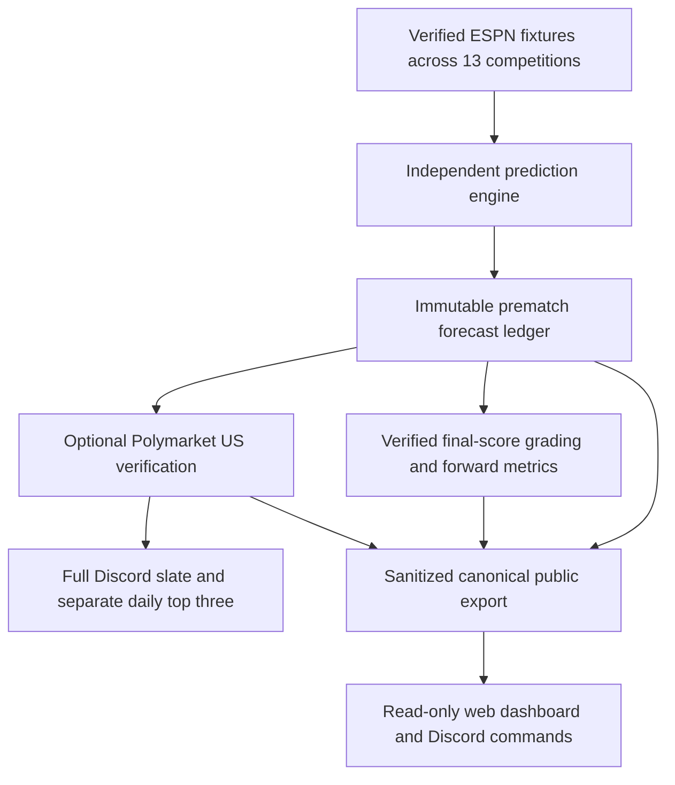

# Independent BTTS prediction platform

The live predictor remains the experimental, uncalibrated rolling Poisson model.
No challenger has earned promotion. Model research and source datasets remain
outside this public repository; only explicit public forecast fields cross the
interface. No account access, monetary P&L, order execution or trading is added.



## Interfaces

The engine's v1 slate contains `schema_version`, `date_central`, `generated_at`,
`trades_placed: 0`, `fixtures` and all 13 competition `coverage` counters.
Only current America/Chicago calendar-day upcoming fixtures are generated.
Adjacent provider query dates do not widen that scope. Already-started matches
are excluded from new issuance. Earlier pending forecasts may be graded later.

A successful forecast has fixture/ESPN event and team IDs, competition, home and
away names, aware kickoff, fixture observation time/source, `prediction_status`,
`p_yes`, `p_no`, `side`, `confidence`, model name/version, creation timestamp,
aggregate historical coverage, reviewed identity status, data-quality status,
`probabilities_calibrated: false`, a frozen prematch prevalence probability where
available, and `prediction_source: forward_recorded`. Probabilities use decimal
strings; confidence is the selected side's probability. The strict implementation
is [prediction_schema.py](../src/prediction_schema.py). Unknown/private fields are
rejected before any public write. Proxy-history forecasts retain their quality
label; absent comparable prevalence evidence stays null.

Failed forecasts have explicit `insufficient_history`, `unresolved_team_identity`,
`missing_fixture_data` or `model_error` status and a bounded reason code. No market
field is part of engine eligibility. Missing scores and identities are not guessed.

The public writer adds a deterministic `prediction_id` and a per-fixture `revision`.
Identity includes forecast content/model/coverage/kickoff but excludes observation
and creation timestamps, so ordinary repeated scans do not duplicate a forecast.
Changed forecasts append a new revision; original probabilities remain intact.

Market annotations contain prediction ID, `provider: polymarket_us`, check time,
and one of `verified_available`, `not_found`, `identity_mismatch`, `market_closed`,
`provider_unavailable`. Actual event/market slugs appear only for a verified open,
unambiguous full-match binary contract. Quotes and order-book depth are not needed
to retain, display, rank or grade forecasts. An outage records failure and invokes
the existing deduplicated private operational alert mechanism.

## Durable storage and failure handling

One bot-authored GitHub Issue indexes each Central calendar day. Forecasts are
append-only comments, with GitHub server creation timestamps, semantic hashes and
unchanged comment timestamps checked on reads. No forecast PATCH operation exists.
Edited, duplicate or post-kickoff records fail closed. A late write is explicitly
quarantined and excluded from issued forecasts, so it cannot contaminate metrics
or erase valid earlier records. Administrative tampering requires integrity review:
GitHub is durable storage, not a physically immutable WORM archive.

Market checks, scan coverage, grades, derived metrics and delivery events are
separate comments. Forecasts are saved **before** Polymarket or Discord is called.
Both scheduled writers share one Actions concurrency group. Pagination must
exhaust; hitting a bound produces an error rather than a truncated slate/history.

Discord delivery reserves each prediction/category before POST. Accepted receipts
retain message/channel IDs. An ambiguous POST or lost receipt is not automatically
resent. Formatting changes cannot bypass that reservation. The full slate is not
capped at three; only separate daily highlights share the existing three-slot cap,
including legacy reservations and fixtures whose kickoff has already passed.
Highlights rank by model estimate when selected, without market-price gating.

## Grading and monitoring

Every issued forecast is eligible for grading regardless of market or delivery.
The grader reuses existing ESPN ID, home/away role, kickoff and `STATUS_FULL_TIME`
checks. Regular-time full-time scores determine actual BTTS and explicit WIN/LOSS.
Pending, postponed, canceled, abandoned, unavailable or mismatched evidence remain
separate non-graded states. Extra-time/penalty-only finals are not silently graded.
Final grades append once, with verified source URL and observation/grading times.

Monitoring reuses the established metric implementation. Overall figures use the
first issued forecast per fixture, preventing revisions from inflating samples.
Model-version groups use the first per fixture/version. Reports include overall,
league, version, month, YES/NO precision/recall/F1, Brier/log loss, sample sizes,
coverage of evaluated prematch fixtures and matched frozen-prevalence comparisons.
Confidence ranges are 50–54.9%, 55–59.9%, 60–64.9%, 65–69.9%, 70–74.9% and 75%+,
with separate side counts/accuracy. Small samples do not certify reliability.
Historical backtests are never imported as actual forward forecasts.

## Publishing and hosting

`docs/predictions-public.json` is built from the same authenticated bot records as
Discord. Explicit allowlists, hash/timestamp checks and score consistency checks
protect the public projection. The snapshot refreshes every ten minutes. A stale
export is labeled; source failure never substitutes an invented empty slate.

The read-only Node service adds `/`, `/api/predictions` and static dashboard assets.
It offers today's complete evaluated slate, separately reserved highlights,
performance and immutable prediction history. It requires no Discord credentials
for web reads. Existing signed interaction checks and operational health remain.
`/btts page:<number>` paginates the complete slate; `/picks` shows delivered
highlights. Register the revised command schema before relying on the page option.

The same frontend can be built with
`python scripts/build_public_dashboard.py --output /tmp/statrally-site` for static
hosting; it fetches only the sanitized public JSON. A manual Pages deployment
workflow is included. Automatic Pages deployment is opt-in through
`STATRALLY_PUBLIC_DASHBOARD_ENABLED`; existing Render deployment policy is unchanged.
Code/tests alone do not prove either hosted frontend has been deployed.

## Verification and operational boundaries

```bash
PYTHONPATH=src python -m unittest discover -s tests -v
node --test discord-app/tests/*.test.mjs
```

Fictional tests cover 14 forecasts with three contracts, a 72% NO forecast, missing
markets, outages, repeats/revisions, immutable records, verified final grading,
unfinished/postponed/canceled outcomes, ambiguous delivery, long Unicode names,
complete pagination, API routes and the common web projection. No fictional test
is written to official Issues, delivered to Discord or counted in performance.
Cross-component contract tests additionally execute the actual champion generator,
ledger, optional market adapter, grade verifier, existing metrics and web serializer.

Schedules remain 4:17 AM watchlist; 5:23 AM, 8:23 AM and 2:23 PM predictions;
11:55 PM grading, DST-aware America/Chicago. Scheduler continuation, receipts,
admin health and legacy official-paper grading remain active. Manual prediction
and grading dispatches default to **no Discord delivery**; scheduled calls publish.
No new routine or fictional preview messages are enabled by these tests.
